English | [Русский](README.ru.md)

  
  
  
  

  

Rosetun is a VPN client for Windows and Linux, built on sing-box and Xray.
A system service protects against leaks independently of the engine.

One developer maintains Rosetun with help from coding agents. Report problems in [Issues](https://github.com/eoftgge/rosetun/issues).

## Highlights

- Kill switch and system DNS protection.
- Experimental Lockdown: protection while disconnected too.
- TUN and System proxy.
- Rules by program, website, IP and list, with separate exits.
- Provider subscriptions, QR codes and `rosetun://` links.
- Local network access and automatic reconnect.
- Tray, notifications and CLI; English and Russian interfaces.

## New in 0.6

- Share rules as a JSON file or through the clipboard. Preview imports and check where a rule sends an address or program. [Rules](https://eoftgge.github.io/rosetun/en/docs/rules/)
- Send selected traffic through two proxy exits in sequence (experimental). [Two-hop exits](https://eoftgge.github.io/rosetun/en/docs/rules/#two-hop)
- Update subscriptions through the main VPN server by default while connected. In TUN mode, a warning can flag a persistent route past the tunnel when the kill switch is off. [Subscriptions](https://eoftgge.github.io/rosetun/en/docs/subscriptions/#updates) · [Protection](https://eoftgge.github.io/rosetun/en/docs/protection/#bypass-warning)
- Choose whether the delay test opens a new connection or reuses one. [Everyday use](https://eoftgge.github.io/rosetun/en/docs/everyday/)
- On Linux, Local network is limited to directly attached networks. Reports, system checks and window restore are available on both systems. [Linux support](https://eoftgge.github.io/rosetun/en/docs/linux/)

## Install

- **Windows 11 x64.** Download the `-setup.exe` installer from the release linked above. [Windows installation](https://eoftgge.github.io/rosetun/en/docs/install/#windows)
- **Debian 13 amd64.** Install the `.deb` package, add your account to the `rosetun` group and restart the computer. The guide lists requirements for Ubuntu and Linux Mint. [Debian installation](https://eoftgge.github.io/rosetun/en/docs/install/#debian-13)
- **Arch Linux.** Build `rosetun-bin` with the recipe in this repository. [Arch installation](https://eoftgge.github.io/rosetun/en/docs/install/#arch-linux)

**Updating from 0.5?** Back up your settings first. The first save in 0.6 moves them to format 9. Keep `config.v8.json` if you need to return to 0.5.1. [Verify downloads, update and restore settings](https://eoftgge.github.io/rosetun/en/docs/install/)

## Documentation

- [User guide](https://eoftgge.github.io/rosetun/en/docs/)
- [Help and troubleshooting](https://eoftgge.github.io/rosetun/en/help/)
- [For providers](https://eoftgge.github.io/rosetun/en/providers/)
- [Build from source](https://eoftgge.github.io/rosetun/en/docs/build/)
- [Security policy and private reporting](SECURITY.md)
- [Security model](https://eoftgge.github.io/rosetun/en/docs/security/)

## Licenses

Rosetun: **GPL-3.0-or-later**, © 2026 Sandaar. [LICENSE](LICENSE).
sing-box: GPL-3.0-or-later; Xray-core: MPL-2.0; Wintun: [Prebuilt Binaries License](installer/third-party/wintun-prebuilt-binaries-license.txt); fonts: OFL-1.1.
[Full notices, component sources and installed licenses](https://eoftgge.github.io/rosetun/en/docs/licenses/).
Rosetun is not affiliated with sing-box, SagerNet or Project X.
