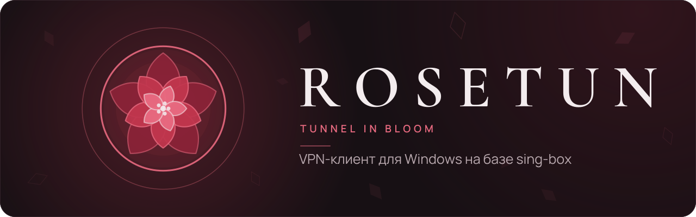

[English](README.md) | Русский

<p align="center"></p>

Rosetun: VPN-клиент для Windows на базе sing-box, который держит туннель, правила и DNS; для серверов VLESS + REALITY соединение с сервером ведёт Xray за sing-box. Служба Windows держит kill switch и замок DNS; правила разделяют трафик по программам, сайтам и IP-адресам, а подписки провайдеров поставляют серверы.

<a href="https://github.com/eoftgge/rosetun/releases"></a>

**Молодой проект:** его ведёт один разработчик с помощью ИИ-агентов, пользователей пока мало. Сообщайте о проблемах в [Issues](https://github.com/eoftgge/rosetun/issues).

## Возможности

- **Kill switch** блокирует трафик при потере туннеля, пока работает служба Rosetun (см. [Как это устроено](#как-это-устроено)). Без него замок DNS не выпускает системный DNS мимо туннеля весь сеанс, даже пока ядро перезапускается.
- **Правила маршрутизации** для программ, сайтов, IP-адресов и подсетей и списков, **Быстрые шаблоны** и действия **Через VPN**, **Напрямую** и **Блокировать**.
- **Направления:** правило может вести свой трафик через другую страну или конкретный узел, а остальное идёт через сервер с главного экрана. Выбор страны или узла в правиле создаёт направление во вкладке **Направления**; там можно сменить его узел и включить запасной: любой узел той же страны. Если узел направления пропал, его правила блокируют трафик и никогда не идут напрямую.
- **Списки:** GeoIP и GeoSite (файлы Xray `.dat`, наборы правил sing-box) и свои текстовые списки из файла или по ссылке. Список по ссылке скачивается заново, только если он изменился (`ETag` / `Last-Modified`).
- Подписки провайдеров: списки ссылок в обычном виде или в base64, Xray JSON и sing-box JSON. **Отправлять ID устройства** (HWID) можно включить для панелей, которым он нужен.
- Серверы VLESS, VMess, Trojan, Shadowsocks и Hysteria2 (обфускация Salamander и смена портов); транспорты TCP, WebSocket, gRPC и HTTPUpgrade для протоколов на TCP; режимы без шифрования транспорта, TLS и Reality. Hysteria2 работает по QUIC поверх UDP. Пока не поддерживаются, такие серверы пропускаются: транспорты XHTTP, SplitHTTP, mKCP, QUIC и HTTP/2, шифрование VLESS, плагины Shadowsocks и другие протоколы.
- **Подключение через Xray** (Настройки → Дополнительно): **Автоматически** (по умолчанию): Xray для серверов VLESS с REALITY, sing-box для остальных; **Без Xray**: sing-box сам соединяется со всеми серверами; **Xray для всех серверов**: через Xray идут все поддерживаемые серверы, кроме Hysteria2. В списке серверов отмечены те, что идут через Xray.
- **DNS через туннель** с настраиваемым DNS-over-HTTPS-резолвером.
- **Локальная сеть** (Настройки → Подключение): роутер, принтер и другие устройства в вашей сети доступны напрямую, мимо туннеля. По умолчанию выключено; в общественных сетях лучше выключить.
- Сервер, правила и DNS можно менять при подключённом туннеле: Rosetun перезапускает его за секунду-две без отключения, а kill switch в это время блокирует трафик.
- **Временные правила:** добавьте правило только до отключения; оно применяется сразу и никогда не сохраняется.
- **Переподключаться при обрыве:** после сна, пропажи сети и падения ядра, со сторожем DNS при подключённом туннеле.
- **Проверки серверов:** пинг TCP (время соединения) и проверка URL с запросом через каждый сервер, в том числе при подключённом туннеле, через ту же цепочку, что и подключение.
- **Проверка системы** (Настройки → Служба и журнал) ищет неверные часы, системный прокси, Zapret или WinDivert, перехватывающие пакеты, другие VPN-клиенты и их адаптеры. После неудачного подключения она запускается сама и ничего не меняет.
- **Собрать отчёт** (Настройки → Служба и журнал) сохраняет один текстовый файл для сообщения об ошибке: версии, настройки без секретов, состояние подключения, проверку системы и журналы. IP-адреса, ссылки, домены, адреса почты, ключи и пароли, имена серверов, подписок, списков и наборов правил, имя учётной записи Windows вычищаются.
- Значок в трее показывает состояние формой: роза цветная только при подключении; в остальных состояниях она серая, а в углу значок: подключение, kill switch блокирует трафик, подключиться не удалось, служба не запущена.
- Командная строка: `rosetun status`, `temporary`, `connect`, `apply`, `probe`, `delay`, `exits`, `select`, `sub add|update|list|remove`, `nodes`, `config`, `xray auto|off|always`, `lan on|off`, `disconnect`, `shutdown`.
- **Запускать вместе с Windows**, интерфейс на русском и английском.

## Установка

Скачайте установщик на странице [Releases](https://github.com/eoftgge/rosetun/releases). Нужна Windows 10 или 11, x64. Установщик пока не подписан: если SmartScreen показывает «Windows protected your PC», нажмите **More info**, затем **Run anyway**.

Rosetun снова подаст заявку в [SignPath Foundation](https://signpath.org) на бесплатную подпись кода, когда проект станет известнее; планируемый порядок подписи описан в [политике подписи кода](CODE_SIGNING_POLICY.md) (на английском). Текущие релизы остаются неподписанными.

Папку установки можно выбрать, но не внутри профиля пользователя и не там, где её могут менять обычные пользователи: служба работает с правами SYSTEM. При удалении настройки в `%APPDATA%\Rosetun` по умолчанию остаются; при желании можно удалить настройки, подписки и правила.
При обновлении формата конфигурации Rosetun оставляет рядом копию прежнего файла (например, `config.v1.json`); в ней сохраняются те же ссылки подписок.

### Проверка загрузки

Сравните результат `Get-FileHash .\rosetun-<version>-setup.exe -Algorithm SHA256` со строкой в `SHA256SUMS.txt` из релиза. Для публичного релиза по тегу проверьте происхождение командой `gh attestation verify .\rosetun-<version>-setup.exe --repo eoftgge/rosetun`.

## Приватность и сетевые обращения

Rosetun обращается в сеть следующим образом:

- К VPN-серверу для туннеля; **Пинг TCP** также пробует установить TCP-соединение с каждым проверяемым сервером при отключённом туннеле.
- **Проверка URL** и задержка на экране подключения отправляют сразу два HTTPS-запроса, к `https://cp.cloudflare.com/generate_204` и `https://www.gstatic.com/generate_204`, через проверяемый сервер, текущий сервер или сервер каждого направления. Проверка URL соединяется с каждым сервером напрямую, мимо туннеля. При подключении и во время соединения служба отправляет те же запросы через текущий сервер, чтобы убедиться, что он работает; это не выключается.
- К провайдеру подписки для загрузки и обновления серверов. По умолчанию отправляется `User-Agent: Rosetun/<версия>`. Если включено **Отправлять ID устройства**, запрос также содержит `x-hwid`, `x-device-os`, `x-ver-os` и `x-device-model`. Ссылка подписки может содержать пароль; при HTTP-подписке токен передаётся без шифрования.
- По адресам списков, которые указали вы или подписка: при добавлении и обновлении списка и вместе с обновлением подписок (выключается в **Обновлять подписки автоматически**). Rosetun отправляет `ETag` / `Last-Modified` прошлой загрузки, поэтому неизменившийся список заново не скачивается. Если туннель подключён, запрос идёт через него.
- К настроенному DNS-over-HTTPS-резолверу через туннель. При подключении служба также проверяет DNS запросом `example.com`, а во время соединения задаёт вопросы о случайных именах под `example.com`.
- К `https://1.1.1.1/cdn-cgi/trace` за внешним IP и страной на экране подключения: через текущий сервер при подключении и напрямую, когда туннель отключён, подключиться не удалось или служба недоступна. Внешний IP по умолчанию скрыт и не записывается в журнал. Направления отдельных запросов не делают: их страна берётся из имени узла.
- К `https://api.github.com/repos/eoftgge/rosetun/releases` за списком релизов при запуске, если проверок ещё не было или с последней удачной проверки прошло больше суток, затем раз в сутки и по кнопке **Проверить сейчас**. Если туннель подключён, запрос идёт через него. Автоматическая проверка включена по умолчанию; выключить её можно в **Настройки → О программе → Проверять обновления**. Время последней удачной проверки и пропущенная версия хранятся в файле настроек. Ничего не скачивается и не устанавливается автоматически.
- **Проверка системы** отправляет HTTP-запрос `HEAD` к `http://cp.cloudflare.com/`, без шифрования, чтобы сверить часы по заголовку `Date`. Она запускается по кнопке **Проверить**, сама после неудачного подключения и в **Собрать отчёт**; без туннеля запрос идёт напрямую, при подключении через туннель.
- Если DNS перестаёт отвечать, сторож отправляет HTTP-запросы `HEAD` к `1.1.1.1:80` и к `connectivitycheck.gstatic.com/generate_204` через туннель, чтобы отличить сбой DNS от потери связи. Второе имя определяется через DNS туннеля при подключении.
- До подключения системный DNS разрешает имя VPN-сервера; операционная система также может разрешать имена провайдера и серверов при проверке пинга.
- При смене сервера во время подключения имя нового сервера определяется через текущий туннель.

С локальным API ядра и с Xray sing-box общается только через loopback. Телеметрии и учётных записей Rosetun нет. Проверка обновлений приложения лишь сообщает о новой версии, ничего не скачивает и не устанавливает. Журналы остаются на этом компьютере; журнал службы доступен только администраторам, а **Собрать отчёт** получает его только для учётной записи Windows, которая запускала подключение. Когда **Подробный журнал** выключен, адреса назначения в сообщениях ядра заменяются на `[hidden]`; адрес VPN-сервера и причина ошибки остаются. Адреса сайтов попадают в журнал лишь при временно включённом **Подробном журнале**. Автоматическое обновление *подписок* не означает обновление приложения.

## Устранение неполадок

- Сначала запустите **Проверку системы** (Настройки → Служба и журнал): она находит другие VPN-клиенты, Zapret или WinDivert, системный прокси и неверные часы. После неудачного подключения она запускается сама и показывает первую находку под ошибкой.
- Другой VPN-клиент в режиме TUN может мешать запуску туннеля. Отключите его и повторите подключение.
- Программа изменения трафика (например, zapret) может ломать соединение с сервером. Исключите адреса VPN-серверов в её настройках.
- **Нет подключения к сети** значит, что у Windows нет работающей сети, и сервер тут ни при чём. Подключение сразу заканчивается этим сообщением. Во время подключения короткая смена сети не обрывает сеанс; при включённом **Переподключаться при обрыве** Rosetun ждёт сеть и подключается, когда она вернётся, а kill switch всё это время держит интернет закрытым.

## Как это устроено

```text
GUI (пользователь) ──именованный канал──► Служба Rosetun (SYSTEM) ──► sing-box.exe ──► TUN
                                               │                           │
                                               │                           └──loopback──► xray.exe (часть серверов)
                                               └── WFP: kill switch / замок DNS
```

Служба (`rosetun-helper-privileged`) запускает sing-box, который держит туннель, правила и DNS. Для серверов, которые идут через Xray, sing-box передаёт соединение по loopback в `xray.exe`; его тоже запускает служба, и он соединяется с сервером. Защитой владеет служба, поэтому закрытие GUI её не снимает, а kill switch держит, пока служба работает. Если сама служба упала, Windows удаляет её фильтры (fail-open). Это нужно, чтобы компьютер не остался без сети навсегда.

## Сборка из исходников

Нужен Rust 1.96 или новее с MSVC под Windows. `cargo build --release` собирает программы, `cargo test --workspace` запускает тесты. Сборка пакета описана в [инструкции к установщику](installer/README.md), проверка с повышенными правами - в [описании стенда VM](tools/README.md).

Перед первым коммитом один раз выполните `git config core.hooksPath tools/hooks`. Хуки не пропускают подписи ИИ и сообщения не по Conventional Commits, файлы патчей, настоящие адреса серверов и имя вашей учётной записи Windows в добавленных строках, а при push неотформатированный код. CI повторяет проверки сообщений и добавленных строк.

## Безопасность

Об уязвимостях сообщайте приватно, см. [SECURITY.md](SECURITY.md).

## Лицензии

Лицензия Rosetun: **GPL-3.0-or-later**, © 2026 Sandaar. Текст в [LICENSE](LICENSE). В составе программы идёт официальная сборка sing-box без изменений, также под GPL-3.0-or-later. Также в составе идёт официальная сборка Xray-core без изменений под MPL-2.0; её исходники приложены к каждому выпуску, а лицензия устанавливается в `licenses/`. Файлы Xray `geoip.dat` и `geosite.dat` не устанавливаются. В исполняемый файл встроен Wintun 0.14.1, авторские права принадлежат WireGuard LLC; он распространяется по [Wintun Prebuilt Binaries License](installer/third-party/wintun-prebuilt-binaries-license.txt). Лицензия и уведомление устанавливаются как `licenses/wintun-prebuilt-binaries-license.txt` и `licenses/wintun.txt`. Шрифты Manrope и Cormorant Garamond распространяются под OFL-1.1. Уведомления о лицензиях крейтов Rust устанавливаются в `licenses/third-party.html`.

Rosetun не связан с sing-box, SagerNet или Project X.


