[English](README.md) | Русский

  
  
  
  

  

Rosetun: VPN-клиент для Windows и Linux на sing-box и Xray.
Системная служба защищает от утечек независимо от ядра.

Rosetun ведёт один разработчик с помощью агентов для кода. О проблемах пишите в [Issues](https://github.com/eoftgge/rosetun/issues).

## Главное

- Kill switch и защита системного DNS.
- Экспериментальный Lockdown: защита и без подключения.
- TUN и системный прокси.
- Правила по программам, сайтам, IP и спискам; отдельные выходы.
- Подписки провайдеров, QR-коды и ссылки `rosetun://`.
- Локальная сеть и переподключение при обрыве.
- Трей, уведомления, командная строка; русский и английский интерфейсы.

## Установка

- **Windows 11 x64.** Скачайте установщик `-setup.exe` со страницы выпуска по кнопке выше. [Установка на Windows](https://eoftgge.github.io/rosetun/docs/install/#windows)
- **Debian 13 amd64.** Установите пакет `.deb`, добавьте свою учётную запись в группу `rosetun` и перезагрузите компьютер. Требования для Ubuntu и Linux Mint перечислены в руководстве. [Установка на Debian](https://eoftgge.github.io/rosetun/docs/install/#debian-13)
- **Arch Linux.** Соберите `rosetun-bin` по рецепту в этом репозитории. [Установка на Arch](https://eoftgge.github.io/rosetun/docs/install/#arch-linux)

## Документация

- [Руководство](https://eoftgge.github.io/rosetun/docs/)
- [Помощь и устранение неполадок](https://eoftgge.github.io/rosetun/help/)
- [Для провайдеров](https://eoftgge.github.io/rosetun/providers/)
- [Сборка из исходников](https://eoftgge.github.io/rosetun/docs/build/)
- [Политика безопасности и приватные сообщения](SECURITY.md)
- [Модель безопасности](https://eoftgge.github.io/rosetun/docs/security/)

## Лицензии

Rosetun: **GPL-3.0-or-later**, © 2026 Sandaar. [LICENSE](LICENSE).
sing-box: GPL-3.0-or-later; Xray-core: MPL-2.0; Wintun: [Prebuilt Binaries License](installer/third-party/wintun-prebuilt-binaries-license.txt); шрифты: OFL-1.1; флаги стран: MIT.
[Полные уведомления, исходники компонентов и установленные лицензии](https://eoftgge.github.io/rosetun/docs/licenses/).
Rosetun не связан с sing-box, SagerNet или Project X.
